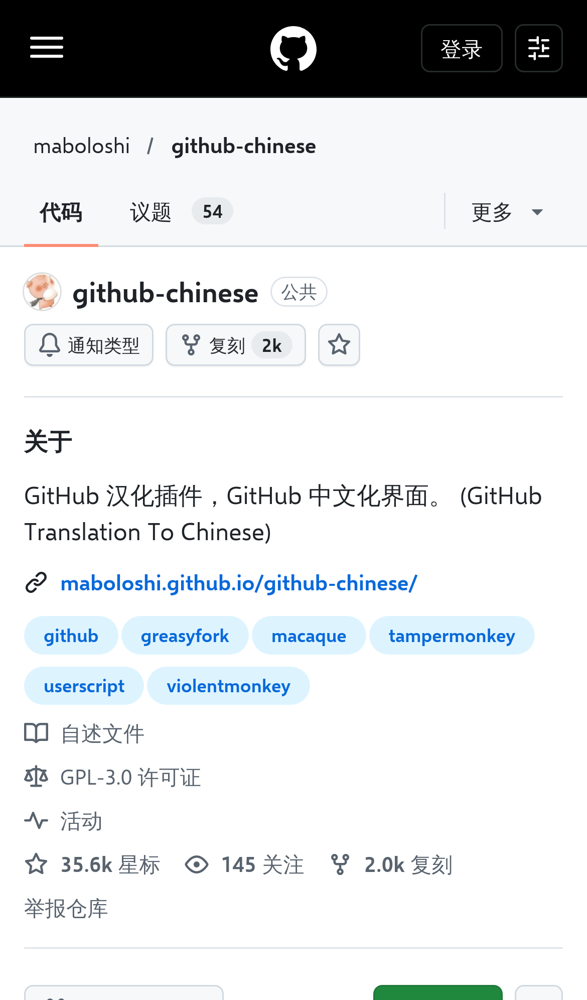
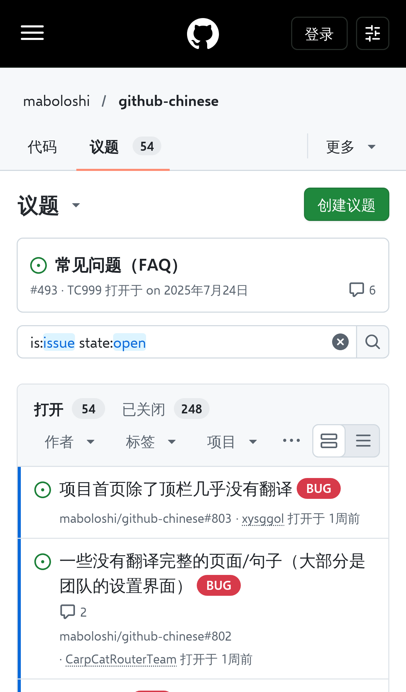

# GitHub 中文化（iPhone 轻量版）

把 GitHub 网页界面翻译成简体中文的用户脚本，是 [maboloshi/github-chinese](https://github.com/maboloshi/github-chinese)（GitHub 中文化插件）的 **iPhone Safari 兼容版**，可在 Stay、Userscripts 等 iOS Safari 扩展中运行，桌面浏览器同样可用。

 

**翻译结果与原版保持一致**：翻译函数逐行移植自原版 `main.user.js`，词库由原版 `locals.js` 原样拆分而来，没有增删或修改任何词条和规则。本项目只改动了“怎么加载、什么时候执行”，以解决原版在 iPhone 上卡死或不运行的问题。

## 安装

脚本地址：

```
https://raw.githubusercontent.com/linyu-yuan/github-zh-lite/main/github-zh-lite.user.js
```

- **iPhone / iPad**：在 App Store 安装 Stay 或 Userscripts，在 Safari 中打开上面的地址并选择安装，然后在“设置 → Safari → 扩展”中允许该扩展访问 github.com 和 gist.github.com。
- **电脑**：安装 Tampermonkey 或 Violentmonkey，打开上面的地址即可安装。

请勿与原版 GitHub 中文化插件同时启用。

## 与原版的区别

原版在 iPhone 上的主要问题和本版的处理方式：

| 原版的问题 | 本版做法 |
| --- | --- |
| 通过 `@require` 加载约 2 MB 的 `locals.js`，部分 iOS 扩展加载失败或每次打开页面都要完整解析一遍 | 词库按页面类型拆成小文件（公共词库约 40 KB，单个页面词库一般几 KB 到几十 KB），存放在本仓库 `dict/` 目录，首次使用时下载一次，之后从 `localStorage` 读取 |
| 依赖 `GM_getValue`、`GM_addStyle`、`GM_registerMenuCommand` 等接口，扩展不支持时脚本在开头就报错，表现为“完全不运行” | `@grant none`，不使用任何 `GM_*` 接口 |
| 翻译后写回页面又触发自身的 MutationObserver，在部分页面形成“写入 → 观察 → 再遍历”的循环，并且整页遍历一次性在主线程完成，页面卡住无法点击 | 自身写入产生的变动记录直接丢弃；遍历按时间片分段执行，单段超时即让出主线程，剩余部分放到空闲时间完成；同一文本的查表/正则结果在当前页面内缓存 |
| 只观察首个 `<body>`，Turbo 替换 `<body>` 后不再翻译新页面 | 观察整个文档，`<body>` 被替换后照常翻译；页面类型变化时按需加载对应词库 |
| 页面加载完毕才开始翻译，英文会先显示一下 | 在 `document-start` 开始监听，边解析边翻译；词库已缓存时首屏翻译完成前短暂隐藏页面（最长 0.3 秒），避免英文闪烁 |

另外：

- 移除 Safari 顶部的“在 GitHub App 中打开”横幅（`meta name="apple-itunes-app"`）。
- 原版的“简介在线翻译”按钮（需要 `GM_xmlhttpRequest` 跨域请求讯飞翻译）和“未命中词条记录”菜单依赖 `GM_*` 接口，本版不包含。

## 工作原理

1. 脚本启动时根据网址、`<body>` 的类名和 `analytics-location` 元信息判断页面类型（与原版 `detectPageType` 相同）。
2. 读取公共词库和该页面类型的词库（内存 → `localStorage` → 从 `raw.githubusercontent.com` 下载）。词库文件名包含内容哈希，更新后自动换新文件。
3. 遍历页面文本节点和元素属性，按原版规则翻译：先查静态词典（页面词条优先于公共词条），再依次尝试页面和公共正则规则；跳过原版配置中的忽略选择器。
4. MutationObserver 监听后续变化（弹出菜单、对话框、站内跳转），新内容按同样规则翻译。
5. 原版针对新版 React 顶栏的翻译补丁同样移植；该补丁需要跨全部词库查找，所以只在页面上出现新版顶栏（登录后）时才下载一次合并词库。

`tools/gen3.js` 把原版 `locals.js` 拆分为 `dict/` 下的 JSON 文件，并把词库中少量以函数形式写的规则（日期、相对时间等）转成 ES5 内联到脚本；`tools/build3.js` 生成最终脚本。

## 致谢与许可

翻译逻辑与词库来自 [maboloshi/github-chinese](https://github.com/maboloshi/github-chinese)（作者 沙漠之子 maboloshi、楼教主 52cik 及众多贡献者），在此致谢。本项目同样以 [GPL-3.0](https://www.gnu.org/licenses/gpl-3.0.html) 许可发布。
