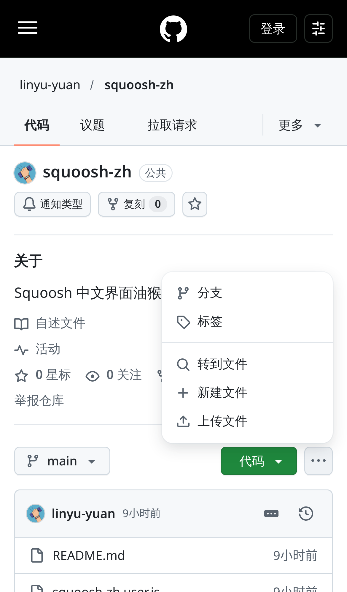
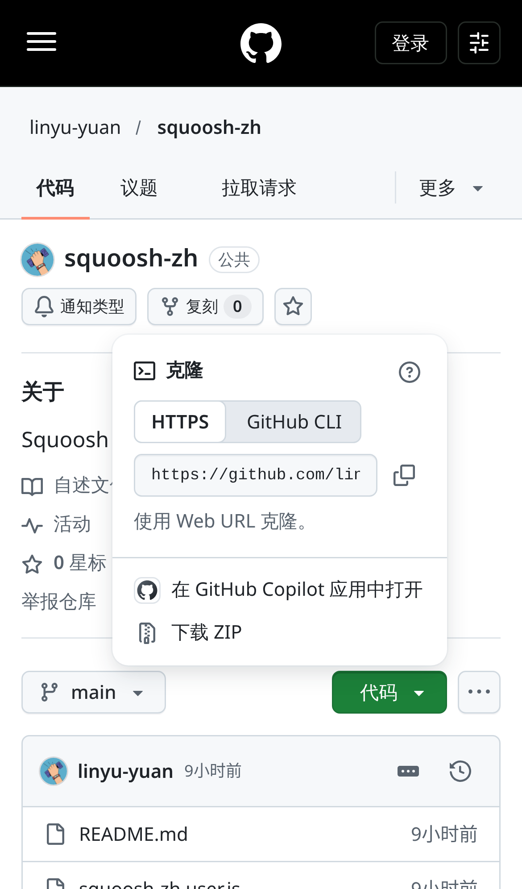

# GitHub 中文化（轻量版）

一个把 GitHub 网页界面翻译成简体中文的用户脚本，专为 iPhone（Safari + Stay / Userscripts）优化，桌面浏览器同样可用。术语采用 GitHub 官方简体中文译法（仓库、拉取请求、议题、复刻、星标、工作流等），拿不准的词保留英文。

 

## 安装

脚本地址：

```
https://raw.githubusercontent.com/linyu-yuan/github-zh-lite/main/github-zh-lite.user.js
```

- **iPhone / iPad**：安装 [Stay](https://apps.apple.com/app/id1591620171) 或 [Userscripts](https://apps.apple.com/app/id1463298887) 扩展，在 Safari 中打开上面的地址并选择安装，然后在 Safari 扩展设置里允许它在 github.com 上运行。
- **电脑**：安装 Tampermonkey（或 Violentmonkey），打开上面的地址即可安装。

## 工作原理

- **小巧的加载器**：脚本本体只包含翻译逻辑和页面类型规则，不内置大词库。
- **按页面加载词库**：根据当前页面类型（仓库、议题、拉取请求、个人主页、设置等）从本仓库 `dict/` 目录下载对应词库和一份通用词库，并缓存在 `localStorage`，之后打开页面无需联网下载。
- **先翻译再显示**：词库已缓存时，页面会短暂隐藏（最长约 0.3 秒），首屏翻译完成后立即显示，避免英文一闪而过。
- **两级匹配**：先按整句精确查表，再用少量模式规则处理带数字的句子（如“剩余 N 个字符”）和日期、相对时间。
- **不碰用户内容**：代码、文件名、提交信息、议题和评论正文、仓库名等保持原样，只翻译界面文字。
- **跟随页面变化**：GitHub 是单页应用，脚本监听整个文档的变化（包括弹出菜单、对话框）和站内跳转，新出现的文字会立即翻译。
- **去掉 App 横幅**：移除 Safari 顶部的“在 App 中打开”提示。

## 已知限制

- 部分新界面或不常见页面可能仍有英文未翻译；无法确定准确译法的词条刻意保留英文。
- 词库更新随脚本版本发布，首次打开某类页面需要联网下载一次词库。
- 屏幕阅读器专用的少量隐藏文字可能保持英文。
- GitHub 改版后个别译文可能暂时失效。

## 致谢与许可

翻译词库与思路基于 [maboloshi/github-chinese](https://github.com/maboloshi/github-chinese)，感谢原作者及贡献者。本项目同样以 [GPL-3.0](https://www.gnu.org/licenses/gpl-3.0.html) 许可发布。
